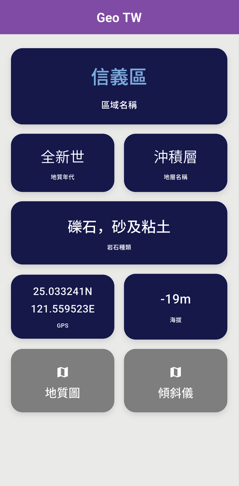
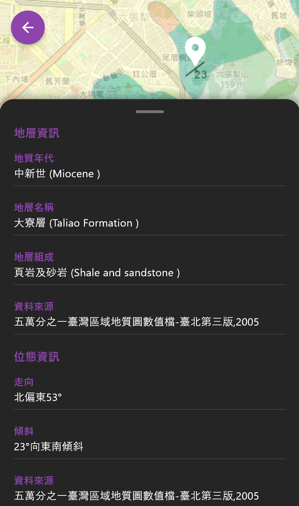
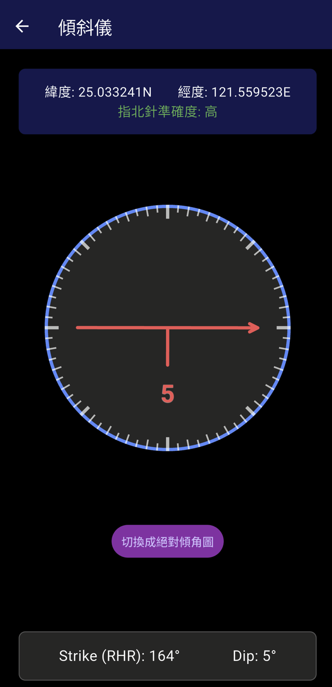
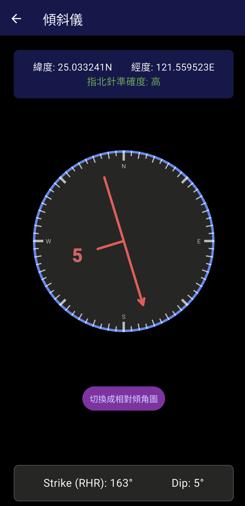
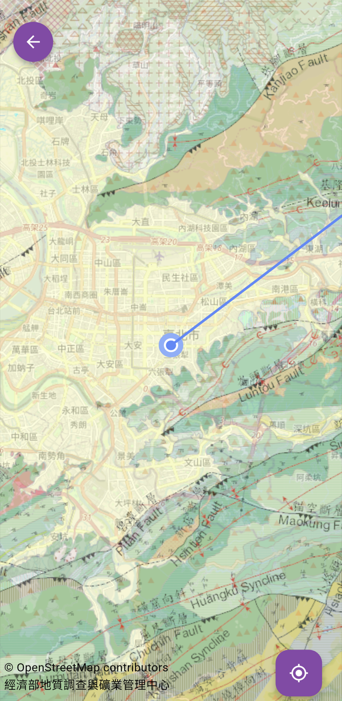

<div align="center">
<a href="https://github.com/KnowScratcher/TwGeoTool" target="blank">

</a>

<h1> 台灣地質工具箱 </h1>




</div>

## 💡 總覽

台灣地質工具箱是一套專為在地化需求打造的地質工具整合軟體。針對現行地質圖資檢視介面操作不便的痛點，本專案提供高效直覺的解決
方案。此外，軟體結合自製傾斜儀功能，支援相對傾角量測及地圖絕對傾角模式轉換，期望能大幅提升野外地質調查與繪圖作業的產出效率。

## ✨ 功能

- **🏠 主畫面資訊:** 主畫面直觀呈現當前位置的地質狀況。
- **🌏 地質圖瀏覽:** 使用地礦中心的開放地質圖API，疊圖在地圖上，掌握即時附近的地質組成。
- **⬆️ 方向指示線:** 將指北針測得之前方方位繪製成方向指示線，閱讀直觀。
- **🔍 地質圖查詢:** 點擊地圖可直接調閱該區塊的地層細節與面頁位態數據。
- **🧭 智慧傾斜儀:** 透過手機量測岩層傾角，系統自動校準傾向，省去調整手機角度的動作。
- **🗺️ 絕對傾斜儀:** 切換至絕對傾斜模式後，圖形直接對齊地圖方位，簡化繪圖流程。

## 🖼️ 範例截圖

<table>
  <tr>
    <td align="center">
      <br>
      <b>主畫面實時地質資訊介面</b>
    </td>
    <td align="center">
      <br>
      <b>資訊調閱</b>
    </td>
  </tr>
  <tr>
    <td align="center">
      <br>
      <b>相對傾斜儀</b>
    </td>
    <td align="center">
      <br>
      <b>絕對傾斜儀</b>
    </td>
  </tr>

  <tr>
    <td align="center">
      <br>
      <b>指向線</b>
    </td>
  </tr>
</table>

## 📦 安裝

### 使用現成的安裝檔

> [!NOTE]
> 目前僅支援Android手機，ios版本目前正在嘗試編譯中
>
> 若您真的需要ios版本，請自行編譯

1. 到[Release](https://github.com/KnowScratcher/TwGeoTool/releases)，點開最新版的`Assets`
   ，下載適合您系統的APK。
2. 打開AKP來安裝。

### 自行編譯

> [!NOTE]
> 若想要自行編譯，請先安裝[Flutter](https://docs.flutter.dev/install)。

1. 複製專案到電腦

```bash
git clone https://github.com/KnowScratcher/TwGeoTool/
cd TwGeoTool
```

2. 編譯檔案

```bash
flutter build apk # 編譯適用全部安卓的APK
flutter build apk --split-per-abi # 編譯更小的安卓的APK(需選擇安裝檔案)
flutter build ios # 編譯IOS的APP
```

編譯結束後可以從訊息中查看執行檔位置。

## 🤝 貢獻

歡迎您來一起讓這個軟體更好. 若要貢獻您的程式碼，請依照以下步驟操作:

1. **創建一個 Fork。**
2. **開一個新的 branch** (`git checkout -b feature/your-feature-name`)。
3. **寫點程式** 然後 commit (`git commit -m 'Add some feature'`)。
4. **Push 到該 branch** (`git push origin feature/your-feature-name`)。
5. **Pull request**。

請記得順便新增相對應的測試。

## 🐛 發現bug嗎

如果你遇到bug, 請先檢查 [Issues](https://github.com/KnowScratcher/TwGeoTool/issues)。若這個不是已被回報問題，請按下
`New Issue`:

在回報的過程中，請注意:

- 寫一個簡潔易懂的標題。
- 詳細說明問題。
- 說明你怎麼找到問題的步驟。
- 若可以，請提供截圖或螢幕錄影。
- 請提供作業系統與軟體版本。

## 📜 授權

此專案使用Apache 2.0授權。更多資訊請見 [License](/LICENSE)。
